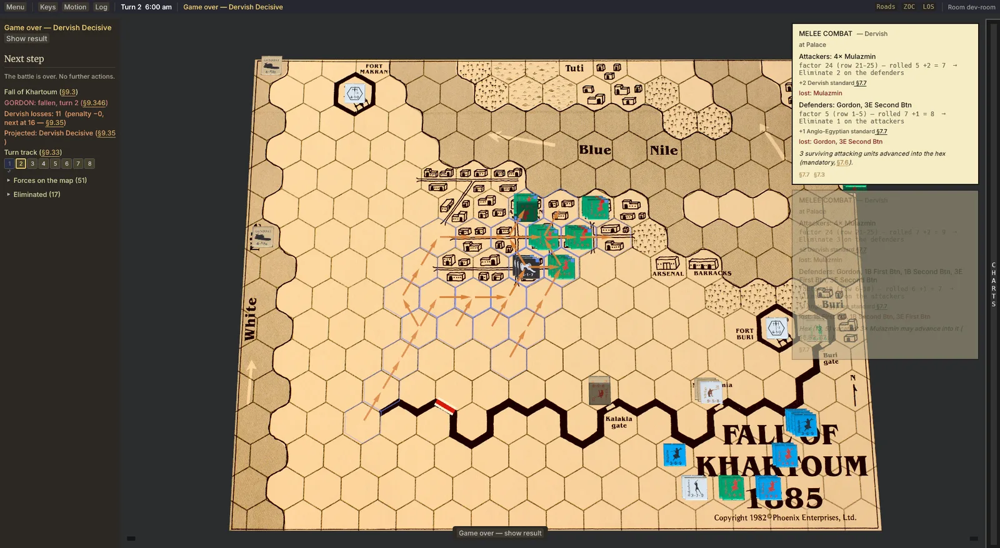
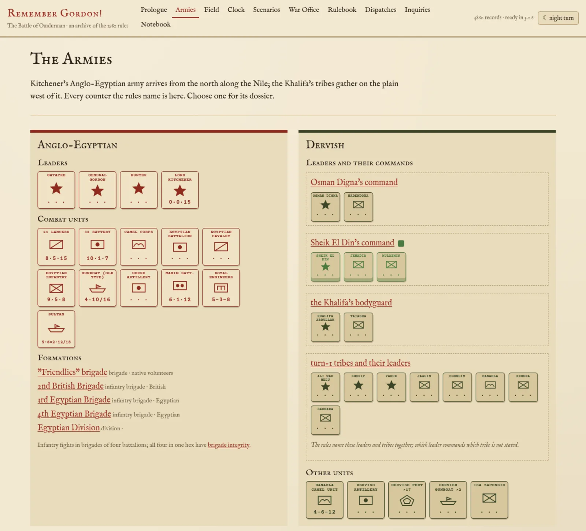

# Remember Gordon!

A digital edition of *Remember Gordon! — The Battle of Omdurman*, the 1982 Phoenix Enterprises
board game: Kitchener's Anglo-Egyptian army against the Khalifa's Dervishes, Sudan, September 1898,
plus the fall of Khartoum in 1885. Written in Rust with Bevy, it runs natively and in the browser,
peer to peer or against the AI, and every rule is traced back to the printed rulebook.

**[Play in the browser](https://barafael.github.io/omdurman/)** ·
**[Rulebook archive](https://barafael.github.io/omdurman/archive/)** ·
**[Rules ↔ code traceability (PDF)](https://barafael.github.io/omdurman/traceability.pdf)**





```sh
cargo run -p omdurman-app        # the game, native
trunk serve                      # the game, in the browser
```

## In this repository

| | |
|---|---|
| [`omdurman-app`](omdurman-app/) | the game: rendering, input, UI, networking glue |
| [`omdurman-rules`](omdurman-rules/) | the rules engine: every mutation is a `GameEffect` applied by `apply_effect` |
| [`omdurman-types`](omdurman-types/) | shared types: hexes, boards, factions, net sequencing |
| [`omdurman-net`](omdurman-net/) | peer-to-peer messages and the replayable event log |
| [`omdurman-bot`](omdurman-bot/) | the AI commander |
| [`omdurman-board-ui`](omdurman-board-ui/), [`omdurman-hexmap`](omdurman-hexmap/) | camera, board view, hex grid |
| [`omdurman-harness`](omdurman-harness/), [`xtask`](xtask/), [`testbox`](testbox/) | the agent harness and the multiplayer test box (`cargo testbox`) |
| [`traceability-macro`](traceability-macro/), [`tools`](tools/), [`docs/traceability.toml`](docs/traceability.toml) | rulebook ↔ code traceability: the index, its checks, the PDF report, an editor LSP |
| [`Boardgame - Remember_Gordon`](Boardgame%20-%20Remember_Gordon/) | the original rulebook, maps and tables, and [the rules corpus](Boardgame%20-%20Remember_Gordon/Manual/surrealdb/) behind the [archive](Boardgame%20-%20Remember_Gordon/Manual/surrealdb/web/) |
| [`docs`](docs/) | [architecture](docs/architecture.md), proofs ([Kani](docs/kani.md)), playtests, design notes |
