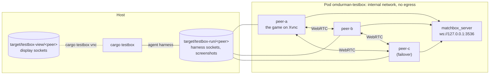

# testbox

Plays omdurman between several peers in one Podman pod on your machine: the game from the working
tree, each peer on a display of its own, meeting on a matchbox signalling server of the box's own
(the `barafael/matchbox` fork at the revision `Cargo.lock` resolves). The pod's network is
internal: nothing in it reaches the internet, the deployed fly.io server or a STUN server. The
peers connect to each other over WebRTC inside the pod, over their host candidates.

After the testbox of `barafael/beep`. `cargo testbox --help` is the reference for the commands;
`cargo testbox` is a Cargo alias (`.cargo/config.toml`) of the `xtask` package.

A pass shows that the protocol -- election, sequencing, history installs, seat rebinding,
healing -- holds over real data channels between real games. Out of reach: NATs and TURN, the
deployed signalling server, the web build. The empirical net harness
(`omdurman-net/tests/replay_reliability.rs`) covers the protocol in miniature over the internet
instead; this box runs the game itself.

## What is in the box



Each peer is the game built as `cargo run -p omdurman-app` builds it (`testbox/peer/Containerfile`),
with `MATCHBOX_SERVER` baked to the box's server, run on TigerVNC's Xvnc
(`testbox/tools` `with-display`) and rendering through Mesa's software Vulkan driver (lavapipe):
the box needs no GPU. It starts in the lobby of the room `testbox`
(`OMDURMAN_START_MODE=lobby`), with a player key of its own (`OMDURMAN_PLAYER_SLOT`), kept across
restarts in the container.

The xtask drives each peer through the game's **agent harness** (`omdurman-app/src/agent.rs`,
protocol in the `omdurman-harness` crate): a Unix socket, armed by `OMDURMAN_AGENT_SOCKET`, taking
one JSON request per line. A `snapshot` reads what the peer holds -- the screen, the net layer (its
id, the host, the peers it sees, the last applied seq, the record's length and a digest of its
events, its unconfirmed submissions), the lobby's roster and the game (turn, phase, seats, pause,
a digest of every unit). An `act` does what a player does, by the road the button takes: pick a
faction, spectate, pick the scenario, start the battle -- or `autoplay`, which plays the local seat
with the in-game AI's commander through the same submission path as a human's orders. A
`screenshot` writes the window as drawn.

## What the host needs

- Linux with rootless Podman (a subuid and subgid range for your user). Netavark makes the
  pod's internal bridge, so the kernel's `bridge` and `veth` modules must load.
- Network while the images build. The base images come from `mirror.gcr.io` (Google's mirror of
  Docker Hub, without Docker Hub's pull rate limit), pinned by digest.
- CPU: every peer renders in software. A few cores per peer.
- For `cargo testbox vnc`: TigerVNC's `vncviewer`.

## Running a phase

Each phase needs a fresh box, the peers starting in an empty room:

```sh
cargo testbox down --wipe
cargo testbox up --peers 2
cargo testbox test core
```

| Phase | Peers | What it checks |
|---|---|---|
| `core` | 2 | the peers meet and agree on a host; the host starts a Fall of Khartoum battle both join; both sides play 40 orders; every record and rules state agrees |
| `rejoin` | 2 | as `core`, then the guest's game restarts mid-battle: it takes its seat back from the history (its key), the pause lifts, play goes on, and the peers agree |
| `failover` | 3 | two players and a spectator; the host leaves mid-battle: the others elect a new host, and pause for the absent seat if the old host held one (the host is the lowest peer id, so it may be the spectator); the old host comes back, to its seat; play goes on under the new host, and the peers agree |
| `signalling` | 2 | the signalling server goes down mid-battle: play goes on over the data channels; it comes back; play goes on, and the peers agree |

Each check prints `check <what>: passed` or `failed: <why>`, a failure with each peer's gist
(screen, peers, host, seq, record, game). `test` fails if any did; last, it checks that no peer's
log says it panicked.

`cargo testbox run` does the three steps for each phase in turn, with the peers each takes, and
sums up: `cargo testbox run --rounds 2` runs every phase twice, `cargo testbox run core rejoin`
only those.

## Looking into a failure

- Every phase leaves a record in `target/testbox-record/<phase>/` (`run`'s in
  `target/testbox-record/run/<round>-<phase>/`): each container's log and each peer's last
  snapshot (`<peer>-snapshot.json`), as they were at the phase's end.
- `test --screenshots` (and `run --screenshots`) also takes each peer's window after each check
  into the record, numbered in the order of the checks (`05-both-sides-play-40-orders-peer-a.png`).
- `cargo testbox vnc peer-a` shows a peer's display, view only.
- `cargo testbox logs peer-a matchbox` prints those containers' logs. The box stays up after
  `test`, so a failed phase can be looked at as it was.
- `cargo testbox down` stops the pod; `down --wipe` removes its volumes too.

## Layout

| Path | What it is |
|---|---|
| `pod.yaml` | The pod for `podman kube play`; `peer.yaml` and `volumes.yaml` are a peer's container and volumes, put in once per peer |
| `matchbox/Containerfile` | The signalling server, at the fork's revision `Cargo.lock` resolves (`xtask/src/pins.rs` checks it) |
| `peer/Containerfile` | A peer: the game, Xvnc, lavapipe |
| `tools/` | `with-display`, the peers' entrypoint |
| `../xtask` | `cargo testbox` itself: the pod, the harness client, the phases' checks |
| `../omdurman-harness` | The agent harness's protocol |
